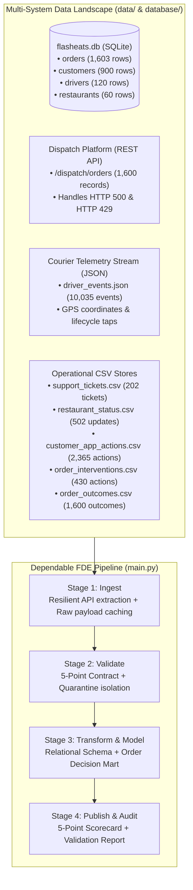
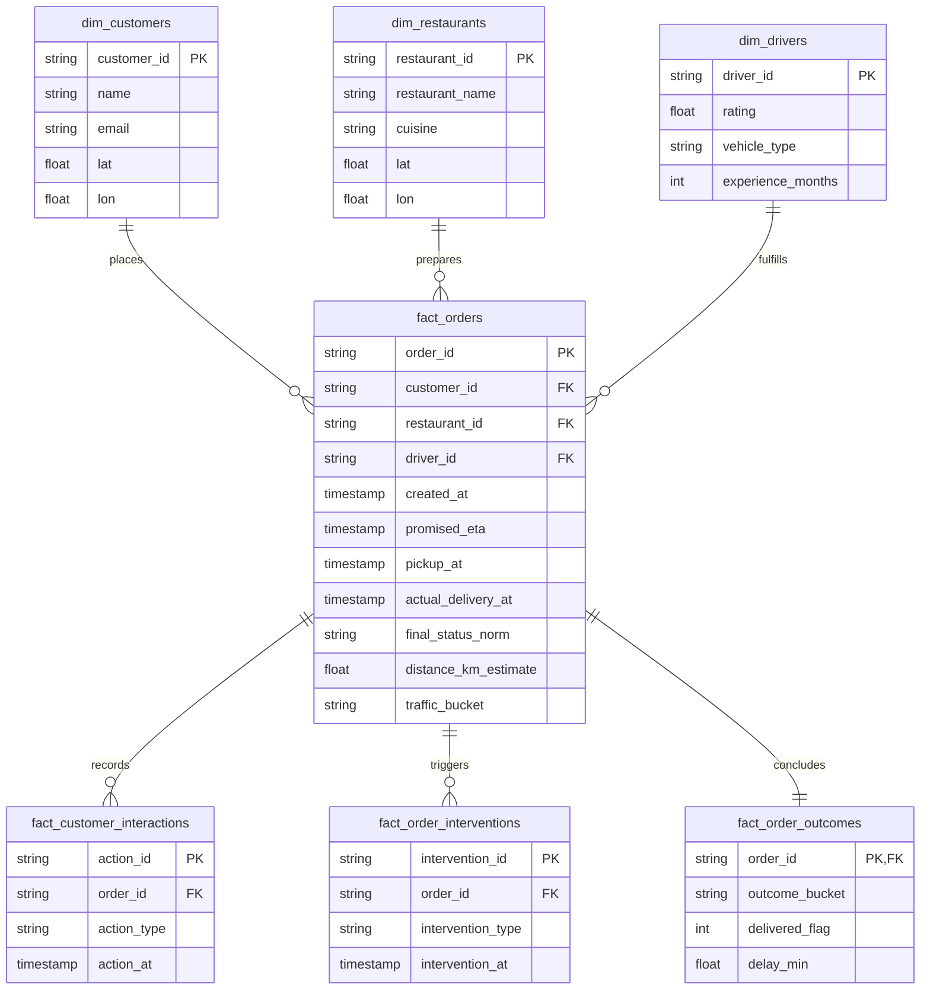

# FlashEats Operations Engineering: Dependable Data Pipeline & FDE Architecture

**Lead Forward Deployed Engineer:** BISHWAYAN CHATTERJEE -- 10200  
**Platform:** FlashEats Hyperlocal Delivery Infrastructure  
**Core Pipeline Entrypoint:** `python main.py`  
**Repository Location:** `HW_2/assignment_2`  
**GitHub Project URL:** `https://github.com/Bish311/FDE_HW`  

---

## 1. Executive Summary & Problem Framing

FlashEats leadership escalated an urgent operational crisis: customer churn was rising rapidly, negative app reviews were mounting, and customer support desks were overwhelmed by complaints regarding delayed meals and volatile delivery estimates.

A legacy analytics dashboard cited across executive meetings asserted:
> **"Late Delivery Rate is 56%."**

Operations diagnosed city traffic as the primary culprit and petitioned for capital to deploy a predictive machine learning delay engine to pad customer delivery estimates. 

As Forward Deployed Engineers (FDE), our mission is **never** to accept unverified assumptions or deploy algorithms to solve an uninstrumented data problem. We embedded directly with the dispatch, merchant, and customer data infrastructure to:
1. **Map and audit the fragmented multi-system data landscape** across relational databases, dispatch APIs, courier telemetry, kitchen status logs, and support desks.
2. **Implement a resilient, fault-tolerant multi-modal ingestion pipeline** that handles network instability and rate limits while preserving immutable raw inputs.
3. **Establish a decision-dependent 5-point validation gate**, stress-testing leadership's 56% claim against empirical reality.
4. **Debunk the operational traffic hypothesis** using correlation analysis and customer grievance mining.
5. **Reconstruct the order lifecycle around the physical business workflow** (Interaction $\rightarrow$ Intervention $\rightarrow$ Outcome).
6. **Architect an auditable, dependable data pipeline** (`ingest` $\rightarrow$ `validate` $\rightarrow$ `transform` $\rightarrow$ `publish`) featuring failure quarantine, idempotency, and run receipts.
7. **Deliver an executive video presentation and strategic roadmap** replacing the misleading 56% metric with an actionable 23.34% operational SLA.

---

## 2. Stakeholder Map & Metric Alignment

| Stakeholder Persona | Core Operational Priority | Historical View | FDE Alignment & Canonical Resolution |
|---|---|---:|---|
| **VP Operations** | Maximize courier utilization and on-time fulfillment | 56.39% (`delay > 0m`) | Replaces zero-tolerance threshold with an actionable 10-minute SLA; targets kitchen prep bottlenecks. |
| **Customer Support Lead** | Lower inbound escalation volume and appease customers | 23.34% (`delay > 10m`) | **Adopted as Canonical Corporate KPI:** Isolates delays that causally trigger customer tickets. |
| **Finance Director** | Protect unit economics, refunds, and driver payout margins | 56.39% (settled only) | Incorporates unrecorded deliveries (37) and cancellations (68) into gross margin leak analysis. |
| **Chief Executive Officer (CEO)** | Long-term customer retention and capital allocation | 56.00% (dashboard) | Terminates $200k+ predictive model project; reallocates funds to merchant hardware and proactive dispatch. |

---

## 3. Data Landscape & System Source Map



---

## 4. Business Workflow & Canonical Data Model

The pipeline models the order journey from checkout through final fulfillment:



---

## 5. Final Evidence Scorecard

The repeatable pipeline produces the verified 5-point operational scorecard:

| # | Operational Metric | Target Baseline | Calculated Value | Operational Meaning |
|---|---|:---:|---:|---|
| **1** | **Operational Late Rate (>10m)** | $< 12.00\%$ | **23.34%** | **Primary Corporate KPI:** Meaningful customer fulfillment failure. |
| **2** | **Severe Delay Rate (>20m)** | $< 3.00\%$ | **8.23%** | Tail risk delays that trigger high customer churn. |
| **3** | **Customer Escalation Rate** | $< 4.00\%$ | **8.62%** | Share of orders requiring support desk agent involvement. |
| **4** | **Proactive Intervention Rate** | $> 35.00\%$ | **26.88%** | Proportion of orders receiving operational dispatch mitigation. |
| **5** | **Order Cancellation Rate** | $< 2.50\%$ | **4.25%** | Guardrail KPI; unfulfilled deliveries resulting in customer abandonment. |

### Stakeholder Comparison Matrix:
- **Leadership Dashboard Claim (`delay > 0m`):** `56.39%` (843 / 1,495) $\rightarrow$ **Vetoed** (inflated by sub-minute variances).
- **Canonical Operational SLA (`delay > 10m`):** `23.34%` (349 / 1,495) $\rightarrow$ **Published Standard**.
- **Total Population Late Rate (`1,600 orders`):** `52.69%` (843 / 1,600).

---

## 6. Knowns, Unknowns, Assumptions & Limitations

| Dimension | Item | Empirical Evidence & Operational Significance |
|---|---|---|
| **Known** | True Meaningful Late Rate is **23.34%** | Measured on 1,495 observed deliveries with $>10$m delay beyond promised ETA. |
| **Known** | Traffic is NOT the primary delay driver | Distance correlation is zero ($r = 0.010$); low traffic late rate is 25.81%. |
| **Known** | Support tickets are 100% caused by lateness | All 138 mobile support openings occurred on late orders; zero on on-time orders. |
| **Unknown** | Restaurant Arrival Timestamps | Unmeasured in courier telemetry (10,035 events); creates an attribution black hole. |
| **Unknown** | True State of 37 Unrecorded Deliveries | Marked 'delivered' with null timestamp; excluded from duration calculations. |
| **Assumption** | Duplicate Orders are Retransmissions | 3 duplicate keys quarantined (`O00120`, `O00723`, `O01302`); first observed record retained. |
| **Limitation** | Merchant Status Coverage is 31.25% | Kitchen telemetry coverage is too low to support platform-wide partner penalties. |

---

## 7. Strategic Decisions Supported by this Pipeline

1. **Veto the Algorithmic Delay-Prediction Engine:** Saves \$180k–\$250k in engineering costs and avoids automating uninstrumented data.
2. **Formally Unify on the 23.34% SLA:** Aligns Operations, Support, and Finance under an unambiguous, auditable threshold.
3. **Close the Attribution Black Hole:** Implements an "Order Ready" kitchen tablet tap and courier geofencing to separate kitchen delays from courier travel.
4. **Automate Priority Dispatch at Minute 15:** Dispatches high-priority couriers for unready orders before customer support tickets occur.

---

## 8. Setup & Execution Instructions

### Run the End-to-End Pipeline
Execute from the project directory:

```powershell
python HW_2/assignment_2/main.py
```

### Structured Enterprise Outputs (`output/`):
- `output/marts/fact_order_mart.csv`: Unified order-level decision table (1,600 records).
- `output/metrics/metrics_scorecard.csv`: Official 5-point executive scorecard.
- `output/metrics/stakeholder_comparison.csv`: Formula-by-formula breakdown across all personas.
- `output/validation/quarantine_orders.json`: 12 isolated data quality anomalies (duplicates, inverted prometas, chronology errors).
- `output/validation/validation_report.json`: Gate audit verdict and stakeholder comparison breakdown.
- `output/audit/pipeline_run_report.json`: Timestamped execution receipt with row counts and ingestion audit logs.

---

## 9. Comprehensive Documentation Index

Each core project requirement has a dedicated document in `docs/`:

| Document | Focus & Detailed Content |
|---|---|
| [`docs/01_source_reasoning_and_mapping.md`](file:///c:/Users/BISHWAYAN CHATTERJEE -- 10200%20Chatterjee/Desktop/random/firse_webdev/rush-hours/FDE_hw/HW_2/assignment_2/docs/01_source_reasoning_and_mapping.md) | Business question to source mapping, grain definition, systems of record, and the attribution black hole. |
| [`docs/02_retrieval_and_raw_preservation.md`](file:///c:/Users/BISHWAYAN CHATTERJEE -- 10200%20Chatterjee/Desktop/random/firse_webdev/rush-hours/FDE_hw/HW_2/assignment_2/docs/02_retrieval_and_raw_preservation.md) | Multi-modal retrieval (SQL, API, CSV/JSON), error recovery (HTTP 500/429), raw caching, and completeness proof ($32 \times 50 = 1,600$). |
| [`docs/03_data_profiling_and_validation.md`](file:///c:/Users/BISHWAYAN CHATTERJEE -- 10200%20Chatterjee/Desktop/random/firse_webdev/rush-hours/FDE_hw/HW_2/assignment_2/docs/03_data_profiling_and_validation.md) | 5-point contract, deconstructing the 56% claim, ghost deliveries, freshness SLA audit, and gate verdict. |
| [`docs/04_workflow_modeling_and_kpis.md`](file:///c:/Users/BISHWAYAN CHATTERJEE -- 10200%20Chatterjee/Desktop/random/firse_webdev/rush-hours/FDE_hw/HW_2/assignment_2/docs/04_workflow_modeling_and_kpis.md) | Workflow lifecycle, ER relational model, decision mart, 5-point scorecard, and the Intervention Paradox. |
| [`docs/05_dependable_pipeline_architecture.md`](file:///c:/Users/BISHWAYAN CHATTERJEE -- 10200%20Chatterjee/Desktop/random/firse_webdev/rush-hours/FDE_hw/HW_2/assignment_2/docs/05_dependable_pipeline_architecture.md) | Pipeline stages, strict idempotency, quarantine mechanics, and structured enterprise output layout. |
| [`docs/06_evidence_scorecard_and_kual.md`](file:///c:/Users/BISHWAYAN CHATTERJEE -- 10200%20Chatterjee/Desktop/random/firse_webdev/rush-hours/FDE_hw/HW_2/assignment_2/docs/06_evidence_scorecard_and_kual.md) | Final evidence dashboard with 5 metrics, stakeholder breakdown, and the complete KUAL boundary matrix. |
| [`docs/07_fde_judgement_call_and_video_demo.md`](file:///c:/Users/BISHWAYAN CHATTERJEE -- 10200%20Chatterjee/Desktop/random/firse_webdev/rush-hours/FDE_hw/HW_2/assignment_2/docs/07_fde_judgement_call_and_video_demo.md) | Critical FDE judgement call (refusing the predictive model, publishing 23.34% SLA), plus the 3–5 minute video demo script. |
