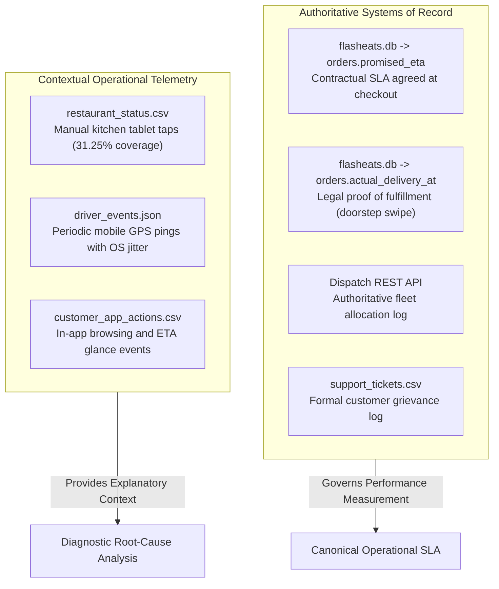

# Source Reasoning, Multi-System Mapping & Operational Audit

**Lead Forward Deployed Engineer:** BISHWAYAN CHATTERJEE -- 10200  
**Platform:** FlashEats Hyperlocal Delivery Infrastructure  
**Core Objective:** Map business questions to required information and source systems; establish source ownership, data grain, and critical telemetry gaps.  

---

## 1. Business Context & System Fragmentation

FlashEats leadership escalated severe customer churn and dissatisfaction regarding erratic delivery estimates. A legacy reporting query claimed:
> **"Late Delivery Rate is 56%."**

Operations attributed this issue entirely to road traffic and demanded an algorithmic delay-prediction engine. 

As Forward Deployed Engineers, our first imperative was to avoid guessing or jumping into algorithms. We conducted an operational audit across the five fragmented data systems powering FlashEats to establish systems of record, data grain, and information ownership.

---

## 2. Business Question to Source Mapping Matrix

| # | Business Question | Required Information | Owning Source System | Source Format | Technical Grain | System Boundary |
|---|---|---|---|---|---|---|
| **1** | When was the order contracted? | Checkout timestamp & promised ETA | Core Order Store (`flasheats.db`) | SQLite (`orders`) | 1 row per order ID | Contractual customer SLA |
| **2** | Who ordered and where is it going? | Customer account, coordinates | Customer Service (`flasheats.db`) | SQLite (`customers`) | 1 row per customer ID | Customer Master Record |
| **3** | Which kitchen prepared the meal? | Restaurant metadata, cuisine | Merchant Platform (`flasheats.db`) | SQLite (`restaurants`) | 1 row per merchant ID | Merchant Master Record |
| **4** | Who fulfilled the delivery? | Driver rating, vehicle, experience | Courier Fleet (`flasheats.db`) | SQLite (`drivers`) | 1 row per courier ID | Courier Fleet Master |
| **5** | When was the courier allocated? | Initial assignment & reassignments | Dispatch Platform (`mock_api`) | Paginated REST API | 1 record per order ID | Dynamic dispatch engine |
| **6** | Where was the courier in transit? | GPS coordinates and movement pings | Mobile Telemetry Stream | Nested JSON (`driver_events`) | Event series per driver | Courier mobile sensor telemetry |
| **7** | When did the kitchen cook the food? | Preparation status milestones | Merchant Kitchen Tablet | CSV (`restaurant_status`) | Multi-row status log | Manual restaurant staff taps |
| **8** | Did the customer escalate a problem? | Ticket creation time & grievance type | Support CRM Platform | CSV (`support_tickets`) | 1 row per support ticket | Customer grievance system |
| **9** | Did dispatch attempt operational recovery? | Priority dispatch, reassignments, credit | Dispatch Operations System | CSV (`order_interventions`) | 1 row per action | Operational mitigation log |
| **10** | What was the final physical outcome? | Terminal status, total delivery delay | Settlement System | CSV (`order_outcomes`) | 1 row per order | Financial reconciliation record |

---

## 3. Authoritative vs. Contextual Source Classification

In a distributed operational architecture, timestamps frequently clash across platforms. We established strict rules of authority:

### Classification Rules:
- **Authoritative (Systems of Record):** Governs SLA compliance and customer contracts. `orders.promised_eta` and `orders.actual_delivery_at` are immutable legal benchmarks.
- **Contextual (Operational Telemetry):** Used for diagnostic root-cause analysis only. Subject to human delay and device sensor sleep states.

---

## 4. The Critical Attribution Black Hole

Our audit of 10,035 driver lifecycle events in `driver_events.json` across 120 couriers identified:
- `assigned`: 1,600 events (dispatch system confirmation).
- `picked_up`: 1,532 events (courier food custody tap).
- `delivered`: 1,495 events (doorstep drop-off swipe).
- `driver_arrived_at_restaurant`: **0 events recorded across the entire fleet**.

### Operational Finding:
The courier mobile app never instrumented a physical restaurant arrival milestone. Without this timestamp:
1. FlashEats cannot measure courier travel time to the merchant.
2. FlashEats cannot distinguish whether a delay was caused by courier transit or by a courier waiting 20 minutes inside an unready kitchen.
3. Training a predictive machine learning delay model on this data would blame couriers for unready food.

**FDE Directive:** We halted model training until physical kitchen handoff milestones are instrumented.
