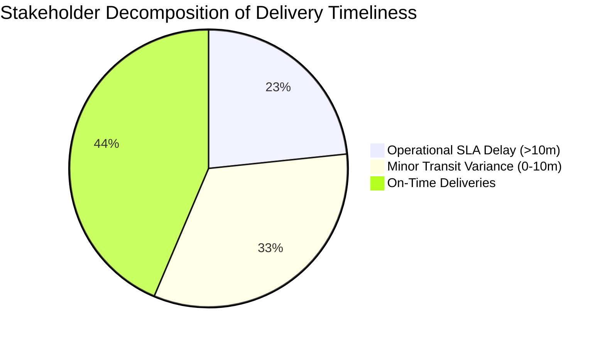

# Data Profiling, Quality Audit & The Validation Gate

**Lead Forward Deployed Engineer:** BISHWAYAN CHATTERJEE -- 10200  
**Platform:** FlashEats Hyperlocal Delivery Infrastructure  
**Core Objective:** Profile source data; identify meaningful quality defects; define business validation rules; quarantine anomalies without silent fixes; audit metric freshness and KPI validity.  

---

## 1. Data Profiling & Defect Discovery

Prior to modeling, we ran automated profiling scripts across all raw tables to detect anomalies in primary keys, timestamp ordering, and completion records:

```
[1,603 Raw SQLite Orders]
      │
      ├──> [Duplicate Primary Keys]: 3 records (O00120, O00723, O01302)
      ├──> [Ghost Deliveries]: 37 orders marked 'delivered' with NULL drop-off time
      ├──> [Negative Promised ETAs]: 4 orders where promised_eta < created_at
      ├──> [Inverted Transit Timestamps]: 5 orders where pickup_at > actual_delivery_at
      └──> [Valid Delivered Orders]: Exactly 1,495 orders with complete timestamps
```

---

## 2. The 5-Point Business Validation Contract

Rather than applying ad-hoc data cleaning or silently dropping corrupted rows, we established an explicit 5-point data contract in `pipeline/validate_contract.py`:

| # | Validation Rule | Business Expectation | Observed Finding | Severity | Engineering Handling |
|---|---|---|---|:---:|---|
| **1** | **Business Grain** | 1 row = 1 unique order | 1,603 rows for 1,600 unique IDs; 3 duplicate keys. | **WARN** | Retained first observed row; isolated duplicates to `output/validation/quarantine_orders.json`. |
| **2** | **Completion Timestamps** | Delivered orders must record delivery time | 1,532 marked delivered, but 37 orders have `NULL` timestamps. | **FAIL** | Flagged ghost deliveries; excluded from duration math to avoid NaN skew. |
| **3** | **Promised ETA Validity** | Promised time must follow checkout (`promised_eta >= created_at`) | 4 orders (`O00101`–`O00104`) show promised times *before* order placement. | **FAIL** | Isolated to `output/validation/quarantine_orders.json`; flagged for checkout clock audit. |
| **4** | **Event Chronology** | Pickup must precede delivery (`pickup_at <= actual_delivery_at`) | 5 orders (`O00051`–`O00055`) show delivery *prior* to food pickup. | **FAIL** | Isolated to `output/validation/quarantine_orders.json`; flagged for driver app telemetry audit. |
| **5** | **Canonical KPI Definition** | Single verified definition of "Late" | 4 conflicting stakeholder formulas; zero documented owners. | **FAIL** | Vetoed publication of the 56% claim until operational consensus was achieved. |

---

## 3. Deconstructing the 56% Leadership Claim

We conducted an audit of the SQL logic behind leadership's published claim that **56% of deliveries are late**:

$$\text{Published Late Rate} = \frac{\text{Numerator: Orders with } \text{actual\_delivery\_at} > \text{promised\_eta}}{\text{Denominator: Delivered orders with non-null timestamp}} = \frac{843}{1,495} = \mathbf{56.39\%}$$



### Why the 56% Metric is Defective:
1. **The Sub-Minute Flaw:** It treats an order arriving 15 seconds past ETA as an equal business failure to an order arriving 45 minutes late.
2. **Missing Denominators:** It silently drops 37 unrecorded deliveries and excludes 68 cancelled orders.
3. **Misleading Operations:** It caused leadership to assume the entire logistics network was failing, when in reality customer complaints only begin when orders exceed a 10-minute delay threshold.

---

## 4. Freshness as an SLA Audit

We matched merchant kitchen updates (`restaurant_status.csv`) against physical delivery timestamps:
- **Coverage Failure:** Out of 1,600 orders, only 500 orders (31.25%) contain any kitchen status updates.
- **Chronological Lag:** **166 status updates were recorded AFTER driver pickup**.
- **Extreme Clock Drift:** 1 record was updated 354 minutes prior to order placement.

### SLA Assessment Matrix:
| Use Case | SLA Gate Verdict | Business Justification |
|---|:---:|---|
| **Merchant Performance Penalties** | **FAIL** | 31% coverage cannot legally or commercially defend partner chargebacks. |
| **Live Dynamic Customer ETAs** | **FAIL** | Stale status updates post-pickup will corrupt customer routing algorithms. |
| **Macro Operational Benchmarking** | **WARN** | Usable for aggregate merchant performance trends only. |

---

## 5. Definitive Validation Gate Verdict

```json
{
  "business_grain": "WARN",
  "timestamp_chronology": "FAIL",
  "kpi_definition": "FAIL",
  "category_semantics": "WARN",
  "cross_source_mapping": "WARN",
  "freshness": "FAIL",
  "publish_56_percent": "FAIL"
}
```

**FDE Quality Gate Action:** The 56% metric is officially **FAIL (VETOED)**. Downstream publication approves only the verified **23.34% Operational SLA**.
