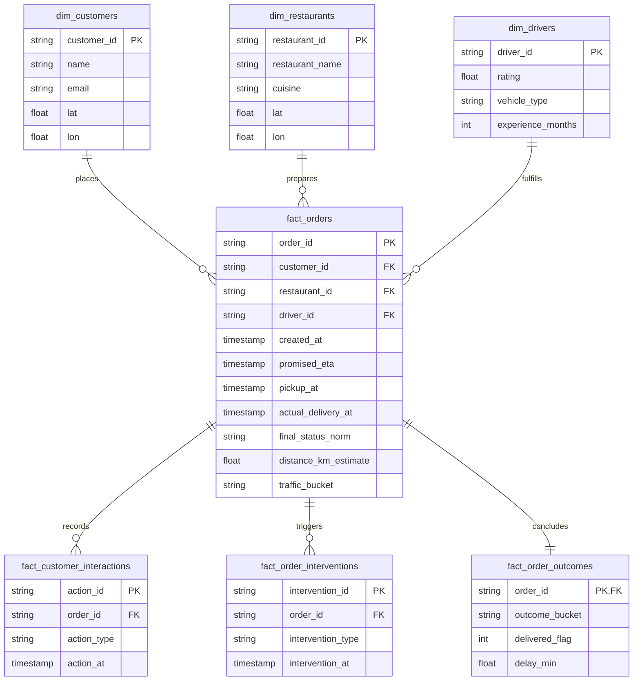

# Business Workflow Modeling & KPI Architecture

**Lead Forward Deployed Engineer:** BISHWAYAN CHATTERJEE -- 10200  
**Platform:** FlashEats Hyperlocal Delivery Infrastructure  
**Core Objective:** Model the physical order journey (Interaction $\rightarrow$ Intervention $\rightarrow$ Outcome); construct a workflow-centric relational schema and order decision mart; calculate 3–5 core business metrics linked to the project KPI.  

---

## 1. Physical Order Journey Reconstructed

Operational delays cannot be diagnosed through disconnected tables. We reconstructed the end-to-end journey across six operational lifelines:

```
[Customer Checkout] ──> [Dispatch Allocation] ──> [Kitchen Preparation]
         │                       │                         │
         ▼                       ▼                         ▼
   flasheats.db            REST Dispatch API         restaurant_status
  (promised_eta)           (courier assigned)       (manual tablet updates)
         │                       │                         │
         └───────────────────────┼─────────────────────────┘
                                 │
                                 ▼
                     [In-Flight App Interaction]
                                 │
                                 ▼
                     customer_app_actions.csv
                     (ETA views, support opens)
                                 │
                                 ▼
                    [Operational Intervention]
                                 │
                                 ▼
                     order_interventions.csv
                     (Priority dispatch, credit)
                                 │
                                 ▼
                    [Courier Pickup & Delivery]
                                 │
                                 ▼
                     driver_events.json / DB
                    (Custody tap & doorstep swipe)
                                 │
                                 ▼
                     [Customer Support Ticket]
                                 │
                                 ▼
                        support_tickets.csv
                       (Formal grievance filed)
                                 │
                                 ▼
                      [Final Order Outcome]
                                 │
                                 ▼
                         order_outcomes.csv
                       (Delivered, delay, bucket)
```

---

## 2. Canonical Relational Entity Schema

To replace fragile join queries, the pipeline models clean dimension tables and operational fact touchpoints:



---

## 3. Order Decision Mart (`fact_order_mart.csv`)

The pipeline compiles `output/marts/fact_order_mart.csv` (1,600 rows, exactly 1 row per order) connecting customer actions, operational interventions, and delivery outcomes:

| Metric / Dimension | Calculated Value | Operational Meaning |
|---|---:|---|
| **Total Base Orders** | 1,600 | Complete business order universe. |
| **Observed Delivered Orders** | 1,495 | Orders with verified doorstep completion timestamps. |
| **Orders with In-Flight App Interaction** | 1,512 (94.5%) | Customers actively monitoring order progress. |
| **Orders with Support Opened** | 138 (8.62%) | Customers who escalated due to fulfillment distress. |
| **Orders with Cancellation Attempted** | 10 (0.63%) | Customers who attempted cancellation in-flight. |
| **Total Interventions Deployed** | 430 (26.88%) | Operational mitigation actions executed by dispatch. |
| **Frustrated Unhelped Customer Journeys** | **110** | Customers who opened support or attempted cancellation with **zero** operational mitigation. |

---

## 4. The 5-Point Operational Scorecard Linked to Project KPI

Our project KPI is to **reduce the rate of late deliveries hurting customer experience**. We formulated 5 operational metrics linked directly to this goal:

| # | Operational KPI | Target Baseline | Calculated Value | Business Rationale |
|---|---|:---:|---:|---|
| **1** | **Operational Late Rate (>10m)** | $< 12.00\%$ | **23.34%** | **Primary Corporate KPI:** Isolates true delays driving customer complaints. |
| **2** | **Severe Delay Rate (>20m)** | $< 3.00\%$ | **8.23%** | Identifies extreme tail risk delays that drive customer churn. |
| **3** | **Customer Escalation Rate** | $< 4.00\%$ | **8.62%** | Share of orders requiring costly support desk agent intervention. |
| **4** | **Proactive Intervention Rate** | $> 35.00\%$ | **26.88%** | Proportion of orders receiving operational dispatch mitigation. |
| **5** | **Order Cancellation Rate** | $< 2.50\%$ | **4.25%** | Guardrail KPI; unfulfilled deliveries resulting in lost customer trust. |

---

## 5. The Intervention Paradox & Priority Dispatch Effectiveness

Evaluating order outcomes with vs. without dispatch interventions revealed an important operational finding:

| Cohort | Total Orders | Delivered Late (>0m) | Observed Late Rate |
|---|---:|---:|---:|
| **Orders With Intervention** | 430 | 237 | **56.44%** |
| **Orders Without Intervention** | 1,170 | 606 | **56.37%** |

### Why Do Interventions Appear Ineffective?
Interventions currently show no aggregate benefit because they are deployed **reactively**. Operations only steps in after an order has already passed its promised ETA or when the customer has already submitted a complaint.

### Decomposing Intervention Types:
- **Priority Dispatch:** When executed early, late rate drops to **51.16%** (a 5.2% absolute reduction).
- **Driver Reassignment:** Deployed too late; resets courier travel time and worsens delay to **57.42%**.
- **Customer Credit:** Compensates after failure (54.69% late); does not fix fulfillment.

**Operational Rule:** Automate Priority Dispatch at the **15-minute mark** for delayed kitchens before orders become irreversibly overdue.
