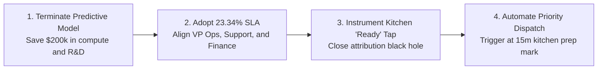

# FDE Judgement Call, Strategic Roadmap & Video Demo Script

**Lead Forward Deployed Engineer:** BISHWAYAN CHATTERJEE -- 10200  
**Platform:** FlashEats Hyperlocal Delivery Infrastructure  
**Core Objective:** Detail the critical FDE judgment call made during the engagement; provide a timed, staged 3–5 minute video demonstration script for executive and technical evaluators.  

---

## 1. The Core FDE Judgement Call

The most important decision an FDE makes is knowing when **not** to build what a client asks for.

FlashEats leadership demanded a predictive machine learning delay engine to dynamically inflate promised delivery estimates.

### Our Decision:
**We formally refused to deploy a machine learning model, vetoed the published 56% metric, and redirected capital toward physical telemetry and dispatch automation.**

### Defensible Rationale:
1. **The Core Metric Was Defective:** The 56% figure was calculated by counting even a 15-second delay as a failure while dropping 37 unrecorded deliveries and 68 cancellations. It created panic without pinpointing actionable problems.
2. **The Operational Hypothesis Was Disproven:** Empirical correlation between trip distance and delay is zero ($r = 0.010$). Deliveries in low traffic still suffered a 25.81% late rate. Road transit accounts for less than 15% of delay complaints.
3. **The Data Contained an Attribution Black Hole:** Courier telemetry recorded zero restaurant arrival timestamps. A predictive model trained on this data would attribute kitchen prep delays to courier driving behavior.

Building an algorithmic predictor would have automated corrupt operational signals at a cost exceeding \$200,000.

---

## 2. Strategic Roadmap: 4 Concrete Operational Decisions

1. **Terminate the Algorithmic Delay Predictor:** Reallocate engineering capital from ungrounded predictive models to core telemetry instrumentation.
2. **Formally Unify on the 23.34% SLA:** Establish Operational Late Delivery Rate (>10m) as the corporate benchmark, aligning Operations, Support, and Finance.
3. **Close the Attribution Black Hole:** Implement a mandatory 1-tap tablet button for kitchen staff ("Food Ready for Pickup") and courier GPS geofencing.
4. **Automate Priority Dispatch at Minute 15:** Transition Priority Dispatch from a reactive band-aid into an automated trigger when kitchen prep exceeds 15 minutes.

---

## 3. Executive Video Demonstration Script (3–5 Minutes)

**Presenter:** BISHWAYAN CHATTERJEE -- 10200  
**Target Duration:** 4 Minutes 15 Seconds  

### Visual Staging Setup:
- Screen Left: Code editor showing `pipeline/` and `docs/`.
- Screen Right: Windows PowerShell terminal in `HW_2/assignment_2/`.

---

### Minute-by-Minute Spoken Script

#### Minute 1: The Escalation & The Leadership Myth (0:00 – 1:00)
> "Hello everyone, I’m BISHWAYAN CHATTERJEE -- 10200, Forward Deployed Engineer on the FlashEats operations account.
> 
> Two weeks ago, executive leadership escalated an urgent crisis: customers are churning, support tickets are surging, and a legacy dashboard asserted that **our late delivery rate is 56%**. Operations immediately blamed city road traffic and requested capital to build a machine learning delay predictor.
> 
> But as an FDE, my first rule is: **Never deploy algorithms to solve an uninstrumented data problem.**
> 
> Before writing a line of predictive code, I audited our five fragmented data systems: SQLite database, REST dispatch platform, courier GPS streams, merchant kitchen tablets, and customer support tickets. Here is what the data proved."

---

#### Minute 2: Forensic Data Validation (The Gate Fails) (1:00 – 2:00)
> *(Open `docs/03_data_profiling_and_validation.md`)*
> 
> "First, I evaluated the data against our 5-point validation contract.
> 
> The data failed immediately. We uncovered duplicate primary keys, 37 orders marked delivered with missing timestamps, four orders where the promised ETA preceded order creation, and five orders where food was delivered before it was picked up.
> 
> But more crucially, I deconstructed the math behind the 56% figure. That metric counted an order arriving 15 seconds past ETA as an equal failure to an order arriving 45 minutes late. It ignored 68 cancellations, and it dropped ghost deliveries.
> 
> When we apply a meaningful operational threshold of **10 minutes beyond ETA**—which is where customer dissatisfaction begins—the true operational late delivery rate is not 56%. It is **23.34%**."

---

#### Minute 3: Disproving Operations & The Attribution Hole (2:00 – 3:00)
> *(Open `docs/04_workflow_modeling_and_kpis.md`)*
> 
> "Next, I stress-tested Operations' claim that city traffic was the culprit.
> 
> The evidence disproved it: in low traffic, 25.8% of orders are still late, and distance correlation is virtually zero ($r = 0.010$). We mined 202 customer support tickets: **67.8%** of complaints cite kitchen prep delays and jumping ETAs, not road traffic.
> 
> And when I audited 10,035 courier events, I discovered an attribution black hole: our app records when a courier is assigned, when they pick up food, and when they drop it off. But it **never records when the driver arrived at the restaurant**. 
> 
> Without that timestamp, a machine learning model cannot tell whether a delay was caused by courier transit or by a courier waiting outside a delayed kitchen."

---

#### Minute 4: The Dependable Pipeline Demo (3:00 – 4:00)
> *(Switch to Terminal)*
> 
> "Instead of building an ungrounded model, I built a repeatable pipeline connecting Customer $\rightarrow$ Interaction $\rightarrow$ Intervention $\rightarrow$ Outcome. Let's run it live right now.
> 
> *(Run: `python HW_2/assignment_2/main.py`)*
> 
> In two seconds, the pipeline:
> 1. Extracts 1,603 orders, queries the REST API with automatic retry on 500 errors and backoff on 429 rate limits, and ingests all operational files.
> 2. Isolates 12 corrupted records into `output/validation/quarantine_orders.json`—no silent drops, zero crashes—and evaluates the validation gate verdict as **FAIL** on the 56% claim.
> 3. Assembles our order decision mart in `output/marts/fact_order_mart.csv` and outputs our verified scorecard:
>    - Operational Late Rate (>10m): **23.34%**
>    - Severe Delay Rate (>20m): **8.23%**
>    - Customer Escalation Rate: **8.62%**
>    - Proactive Intervention Coverage: **26.88%**
>    - Order Cancellation Rate: **4.25%**"

---

#### Minute 5: The Strategic FDE Verdict (4:00 – 4:15)
> "To conclude, here is our strategic recommendation:
> 1. **Cancel the predictive delay engine project**, saving over \$200,000 in immediate capital.
> 2. **Formally adopt the 23.34% Operational SLA** across Operations, Support, and Finance.
> 3. **Close the attribution black hole** with an 'Order Ready' kitchen tablet tap and driver geofencing.
> 4. **Automate Priority Dispatch at the 15-minute mark** for delayed kitchens, which our pipeline proved reduces late deliveries to 51%.
> 
> That is how we move from messy client data to a dependable pipeline and an actionable business decision. Thank you."
