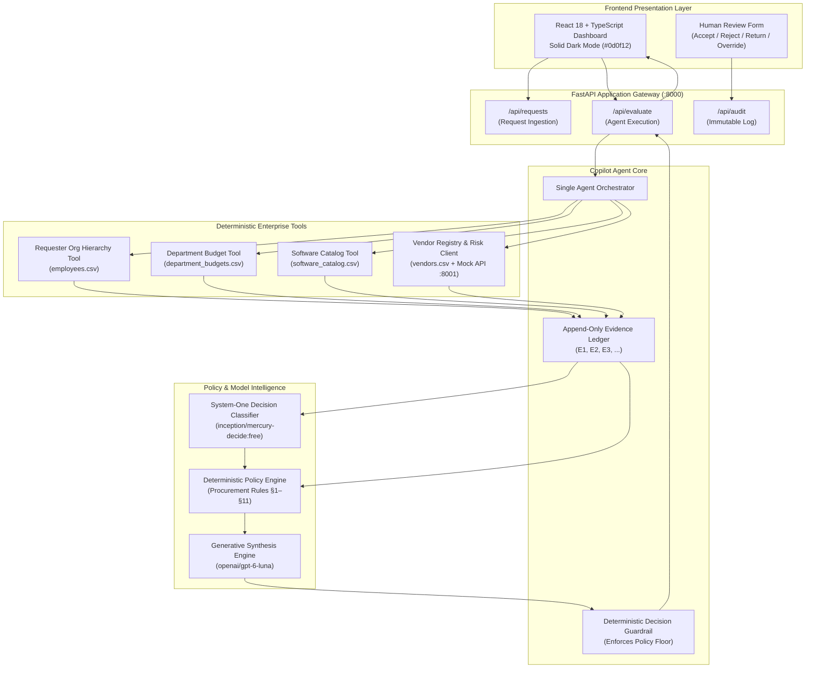
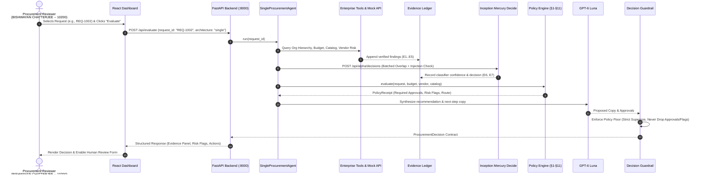
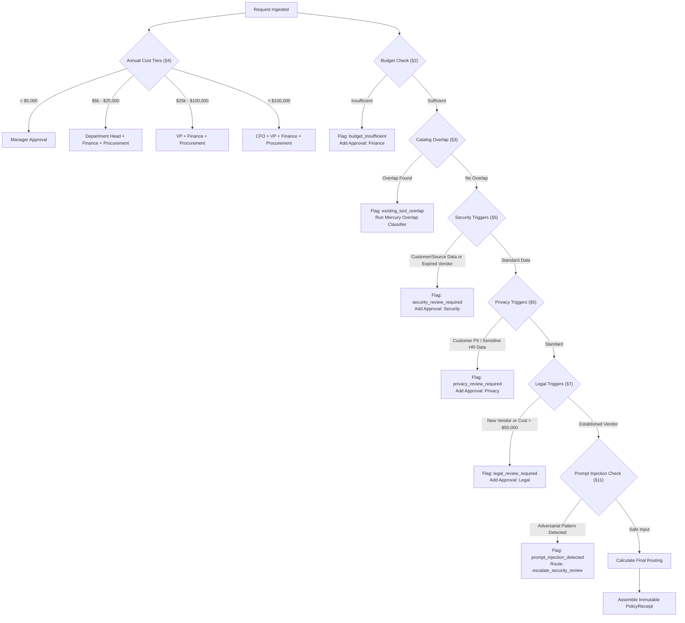
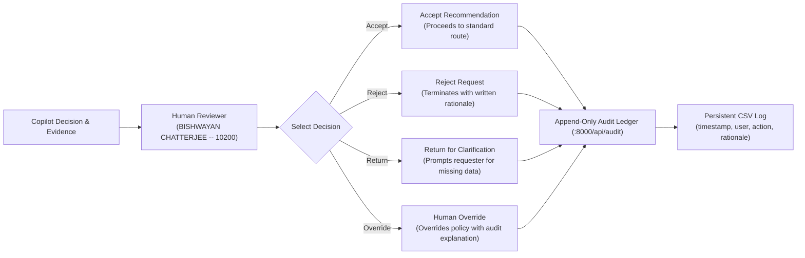

# Architecture Specification: AI Procurement Request Copilot

**Author:** BISHWAYAN CHATTERJEE -- 10200  
**Date:** October 11, 2026  
**System:** AI Procurement Request Copilot  
**Version:** 2.0 (Production Architecture A)

---

## 1. High-Level System Architecture

The AI Procurement Request Copilot operates under a **Deterministic-First, Hybrid Model Gating** paradigm. Pure algorithmic code strictly enforces procurement policy rules, financial thresholds, and security triggers, while lightweight System-One classification models (`inception/mercury-decide:free`) provide instant risk gating, and reasoning LLMs (`openai/gpt-6-luna`) draft contextual stakeholder communication.

---

## 2. End-to-End Request Evaluation Sequence

Every procurement request undergoes a 5-stage verification sequence with full telemetry logging and non-negotiable guardrails.

---

## 3. Architecture Comparison: Single Agent vs. Staged Two-Agent

The project evaluated two architectural paradigms head-to-head on an identical test harness:

```mermaid
flowchart LR
    subgraph ArchA ["Architecture A: Single Agent Baseline (Selected)"]
        direction TB
        A_In["Procurement Request"] --> A_Agent["Unified Agent Orchestrator"]
        A_Agent --> A_Tools["Tool Gathering<br/>(4 Tools)"]
        A_Tools --> A_Ledger["Evidence Ledger"]
        A_Ledger --> A_Gating["Mercury Decide<br/>(Batched Gating)"]
        A_Gating --> A_Policy["Policy Engine (§1-§11)"]
        A_Policy --> A_Luna["GPT-6 Luna Synthesis"]
        A_Luna --> A_Guard["Decision Guardrail"]
        A_Guard --> A_Out["Final Procurement Decision<br/>(Avg Latency: 4,628 ms | 100% Pass)"]
    end

    subgraph ArchB ["Architecture B: Staged Two-Agent Pipeline"]
        direction TB
        B_In["Procurement Request"] --> B_Agent1["Agent 1: Procurement Analyst"]
        B_Agent1 --> B_Tools["Tool Gathering<br/>(4 Tools)"]
        B_Tools --> B_Handoff["Evidence Pack Serialization<br/>(Inter-Agent State Handoff)"]
        B_Handoff --> B_Agent2["Agent 2: Policy Reviewer"]
        B_Agent2 --> B_Gating["Mercury Decide<br/>(Batched Gating)"]
        B_Gating --> B_Policy["Policy Engine (§1-§11)"]
        B_Policy --> B_Luna["GPT-6 Luna Synthesis"]
        B_Luna --> B_Guard["Decision Guardrail"]
        B_Guard --> B_Out["Final Procurement Decision<br/>(Avg Latency: 5,182 ms | 100% Pass)"]
    end
```

### Architectural Trade-Off Analysis

| Dimension | Architecture A (Single Agent) | Architecture B (Staged Two-Agent) | Engineering Verdict |
|---|---|---|---|
| **Compliance Pass Rate** | **100.0% (18/18)** | **100.0% (18/18)** | **Tie**: Safety is enforced by code, not agents. |
| **Average Latency** | **4,628.2 ms** | **5,182.4 ms** | **Arch A is 10.7% faster** (zero handoff delay). |
| **p95 Latency** | **5,222.2 ms** | **5,935.6 ms** | **Arch A is 12.0% faster** in high-variance runs. |
| **Failure Surface** | In-memory execution trace | JSON serialization & schema drift | **Arch A**: Eliminates inter-agent failure points. |
| **Telemetry & Audit** | Single unified `RunTelemetry` trace | Split traces requiring correlation IDs | **Arch A**: Clean, single-pane observability. |

---

## 4. Deterministic Policy Engine (§1–§11) Workflow

The deterministic policy engine executes hard business rules that the generative model cannot alter or suppress:

---

## 5. Human-in-the-Loop Governance & Audit Trail

The copilot strictly respects human authority. Autonomous purchasing is disabled; `human_review_required` is permanently locked to `true`.

---

## 6. System Specifications & Port Mapping

| Component | Technology | Port / Host | Purpose |
|---|---|---|---|
| **Mock Vendor-Risk API** | FastAPI / Uvicorn | `http://127.0.0.1:8001` | External vendor risk scoring service |
| **Backend Copilot API** | FastAPI / Uvicorn | `http://127.0.0.1:8000` | Tool runner, policy engine, evaluation API |
| **Frontend Dashboard** | React 18, Vite, TypeScript | `http://localhost:5173` | Human reviewer dashboard (Dark Mode) |
| **Classifier Model** | `inception/mercury-decide:free` | OpenRouter Decisions API | System-One rapid gating for overlap & security |
| **Reasoning Model** | `openai/gpt-6-luna` (medium) | OpenRouter Chat API | Contextual copy synthesis & justification drafting |
